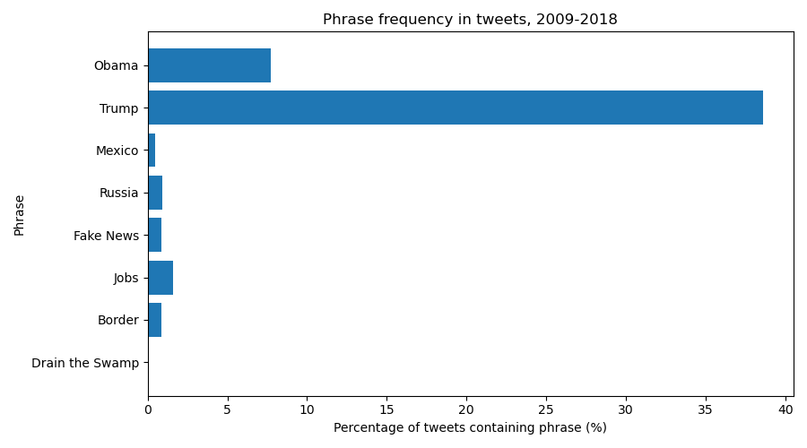

# Web Data Lab

## Phrase frequencies in tweets (2009–2018)

|          Phrase | Percentage |
| --------------: | ---------: |
|           Obama |     07.73% |
|           Trump |     38.58% |
|          Mexico |     00.45% |
|          Russia |     00.91% |
|       Fake News |     00.88% |
|            Jobs |     01.59% |
|          Border |     00.85% |
| Drain the Swamp |     00.02% |

## Description

Before counting, I predicted that "Trump" would be the most common phrase, followed by "Obama" and "Fake News", with "Drain the Swamp" the rarest. "Trump" did dominate at 38.58% of tweets, largely because the account frequently referenced its own name, brand, and properties, and "Obama" was a clear second at 7.73%. The biggest surprise was "Fake News": despite being a signature phrase, it appeared in only 0.88% of tweets, likely because it only entered regular use around 2017, so it had just two of the ten years to accumulate. "Jobs" (1.59%) beat every policy phrase, and "Drain the Swamp" was even rarer than expected, appearing in only 8 tweets (0.02%).